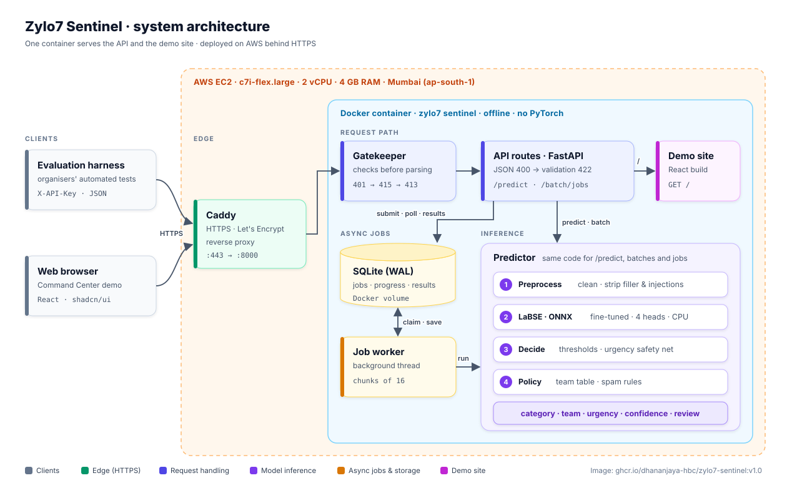
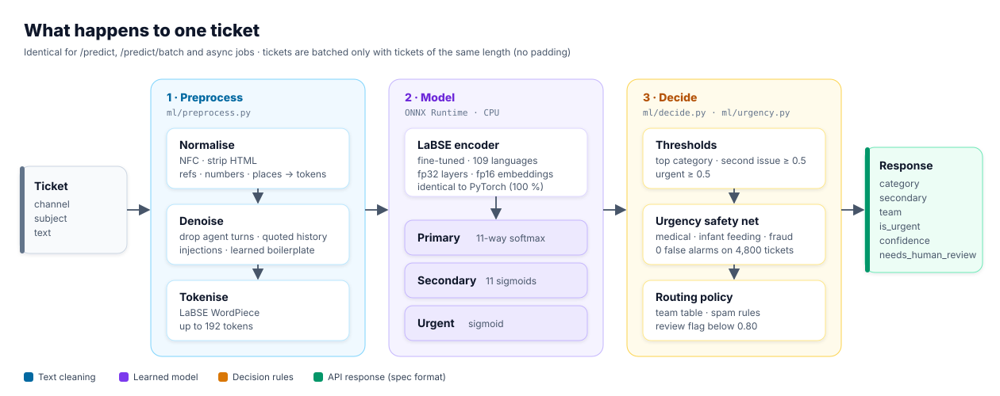
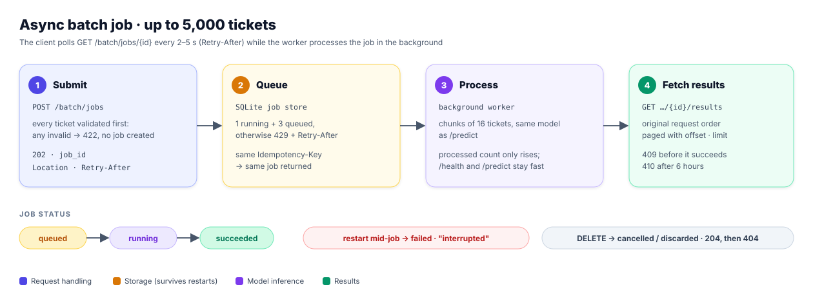
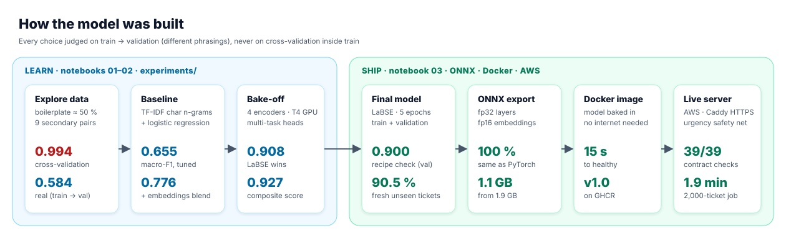

# Zylo7 Sentinel

**Multilingual support-ticket classification and routing for RideEat**: English, Sinhala, Tamil, Singlish and
Tanglish tickets are classified, prioritised and routed to the right team by a fine-tuned **LaBSE** model served
with ONNX Runtime on CPU. Built for **TensorForge 2.0, Phase 2** by **Team Zylo7**.

| | |
|---|---|
| **Live demo** | https://zylo7-sentinel.duckdns.org |
| **API base URL** | `https://zylo7-sentinel.duckdns.org` (contract: [`specs/tensorforge-phase2-openapi-v2.yaml`](specs/tensorforge-phase2-openapi-v2.yaml)) |
| **Container image** | `ghcr.io/dhananjaya-hbc/zylo7-sentinel:v1.0` |
| **Video** | _link added at submission_ |
| **Report** | _link added at submission_ |

## Results at a glance

| What | Result | Where it comes from |
|---|---|---|
| Category macro-F1 on **unseen phrasings** | **0.900** shipped recipe · 0.908 bake-off | LaBSE trained on train, scored on validation · [`experiments/final_model`](experiments/final_model) · [`experiments/model_b_bakeoff`](experiments/model_b_bakeoff) |
| Hand-written fresh tickets (42, never seen) | **90.5 %** category accuracy · urgent recall **1.00**, urgent F1 **0.957** | [`experiments/fresh_test`](experiments/fresh_test) |
| Urgency safety net on all 4,800 labelled tickets | precision **1.00**, **0** false alarms | [`experiments/urgency_net`](experiments/urgency_net) |
| API contract (judge simulator, live server) | **39 / 39** checks | [`scripts/harness.py`](scripts/harness.py) |
| 2,000-ticket async job | **1.9 min** (spec: 15 min) | live server, 2 vCPU / 4 GB |
| Start-up, no internet | `/health` 200 after **15 s** (spec: 120 s) | `docker run --network none` |
| Exported model vs PyTorch | **100 %** identical predictions (max prob. diff 5e-7) | ONNX parity check |
| Automated tests | **118** passing | `uv run pytest` |

---

## Quickstart

### Run the published image (recommended)

```bash
docker run -p 8000:8000 -e API_KEY=<key> ghcr.io/dhananjaya-hbc/zylo7-sentinel:v1.0
```

The model is inside the image; nothing is downloaded at runtime. `/health` returns `503 loading` for a few seconds,
then `200`. Open http://localhost:8000 for the demo site.

> The image is built for `linux/amd64` (the usual evaluation hardware). On Apple-silicon Macs it runs through
> emulation, which works but is slower.

```bash
curl http://localhost:8000/health

curl -X POST http://localhost:8000/predict \
  -H "X-API-Key: $API_KEY" -H "Content-Type: application/json" \
  -d '{"ticket_id":"T-1","channel":"chat","text":"amma leda wela thawa peyakin beheth oni"}'

curl -X POST http://localhost:8000/batch/jobs \
  -H "X-API-Key: $API_KEY" -H "Content-Type: application/json" \
  -d '{"tickets":[{"ticket_id":"A","channel":"email","subject":"Late","text":"My order is two hours late"}]}'
# then: GET /batch/jobs/{job_id}  ->  GET /batch/jobs/{job_id}/results
```

### Build from source

The 1.1 GB model bundle is too large for git, so it is downloaded once before building:

```bash
MODEL_URL="https://drive.google.com/file/d/1mD21lT54sDkiR_xtm6ymVLFKR0i12l3W/view?usp=share_link" \
  scripts/fetch_model.sh                          # downloads + checksum-verifies models/active/
docker build -t sentinel .
docker run -p 8000:8000 -e API_KEY=<key> sentinel
```

---

## Architecture

### System

<p align="center"></p>

- **One container** serves the API and the demo site. The model, tokenizer and site are baked into the image.
- **Gatekeeper** runs before any parsing, in the spec's order: auth (401) → content type (415) → size (413), then
  the route parses JSON (400) and validates (422). An unauthorised request never reaches the model.
- **Async jobs** live in SQLite on a Docker volume and are processed by one background thread in small chunks, so
  `/health` and `/predict` stay fast while a 5,000-ticket job runs. A restart marks running jobs
  `failed / interrupted`; queued jobs resume.

### What happens to one ticket

<p align="center"></p>

- Tickets in a request are grouped by **identical token length**, so no padding is ever added: a ticket gets the
  exact same answer alone, in a batch, or in a job, at any position.
- `POST /predict?explain=true` (used by the demo) also returns which segments the model read and why a ticket was
  flagged urgent. The judges' calls never include it.

### Async batch job

<p align="center"></p>

### How the model was built

<p align="center"></p>

---

## How the model was trained, validated and improved

1. **Data exploration** ([`notebooks/01_data_exploration.ipynb`](notebooks/01_data_exploration.ipynb)).
   4,000 train + 800 validation synthetic tickets, 11 categories, 6 language styles. About half of a typical ticket
   is boilerplate; ~10 % have a second issue (in 9 fixed pairs); ~10 % are urgent.
2. **The trap.** Validation describes the same issues with **different phrasings** (only ~20 % of its phrases occur in
   train). A TF-IDF model scored **0.994** in cross-validation inside train but **0.584** on validation: it had
   memorised templates. From then on every choice was made on **train → validation**, never on cross-validation.
3. **Preprocessing** ([`ml/preprocess.py`](ml/preprocess.py)), shared by training and serving: Unicode NFC (keeps
   Sinhala/Tamil combining marks), HTML stripping, placeholders for references/numbers/places, removal of agent
   turns, quoted history and prompt injections, and a **learned boilerplate lexicon** (repeated segments whose labels
   are spread evenly across categories).
4. **Baseline**: character n-gram TF-IDF + logistic regression, tuned to **0.655** macro-F1 on validation.
5. **Encoder bake-off** ([`notebooks/02_encoder_bakeoff.ipynb`](notebooks/02_encoder_bakeoff.ipynb)): four
   multilingual encoders fine-tuned with the same **multi-task heads** (primary, secondary, urgency, plus a
   training-only language head that uses the `language` column the API never sends):

   | Encoder | Macro-F1 | Secondary F1 | Urgent F1 | Composite |
   |---|---|---|---|---|
   | **LaBSE** | **0.908** | **0.933** | 0.956 | **0.927** |
   | multilingual-e5-base | 0.839 | 0.868 | 0.962 | 0.882 |
   | XLM-RoBERTa base | 0.846 | 0.819 | 0.856 | 0.843 |
   | multilingual-e5-small | 0.810 | 0.324 | 0.917 | 0.745 |

   Blending with Model A or a second encoder did not help, and tuned thresholds overfit in cross-fitting, so the
   shipped system is a single LaBSE with default thresholds.
6. **Final model** ([`notebooks/03_final_model_training.ipynb`](notebooks/03_final_model_training.ipynb)): the same
   recipe refit on train + validation, exported to ONNX. Dynamic int8 quantisation agreed with PyTorch on only
   90–92 % of tickets, so it was rejected; fp32 layers with an fp16 embedding table agree on **100 %** and shrink
   the model from 1.9 GB to 1.1 GB.
7. **Urgency safety net** ([`ml/urgency.py`](ml/urgency.py)). On hand-written fresh tickets the model missed urgent
   medical, infant-feeding and fraud cases phrased in new ways. In all 4,800 labelled tickets these themes are always
   urgent, so a curated multilingual rule turns urgency on for them (never off, never for spam). Verified before
   shipping: precision 1.00, 0 false alarms, covering 222 of 480 urgent tickets; on the fresh set urgent recall rose
   from 0.73 to **1.00**.

## The `needs_human_review` flag

`needs_human_review = true` when the confidence in the primary category is **below 0.80**.

| Confidence band (validation) | Tickets | Accuracy |
|---|---|---|
| ≥ 0.95 | 604 | 99.5 % |
| 0.80 – 0.95 | 104 | 67.3 % |
| 0.60 – 0.80 | 53 | 64.2 % |
| < 0.60 | 39 | 43.6 % |

At 0.80, **11.5 %** of tickets go to a human, and the automatically routed rest are **94.8 %** accurate. Confidence
is the model's calibrated softmax probability (ECE ≈ 0.04), so it reflects real uncertainty.

## API compliance

- Endpoints: `GET /health` (public), `POST /predict`, `POST /predict/batch` (1–100), `POST /batch/jobs` (≤ 5,000),
  `GET /batch/jobs/{id}`, `GET /batch/jobs/{id}/results` (paged), `DELETE /batch/jobs/{id}`.
- Auth: `X-API-Key` or `Authorization: Bearer`, read from `API_KEY` at start-up, constant-time comparison, never
  logged; without `API_KEY` every protected request gets 401.
- Errors: always `{"error": {"code", "message", "details?"}}`; batch errors list every failing item with its `index`.
  Unknown routes and methods return JSON 404/405; nothing returns HTML or a stack trace.
- Jobs: 202 + `Location` + `Retry-After`, `Idempotency-Key`, 1 running + 3 queued (else 429), 409 before success,
  410 after 6 h, DELETE → 204 then 404, restart → `failed / interrupted`.
- Consistency: team from the fixed table, secondary ≠ primary, spam is never urgent and has no secondary.

## Testing

```bash
uv sync                                   # Python 3.12 environment
uv run pytest                             # 118 tests: preprocessing, contract, status codes, jobs, ONNX serving
uv run python scripts/harness.py --base-url http://localhost:8000 --job-size 2000   # judge simulator
uv run python scripts/eval_fresh.py --tag check --base-url http://localhost:8000    # fresh unseen tickets
uv run python scripts/verify_urgency_net.py                                         # urgency rule on 4,800 tickets
```

## Repository map

| Path | Contents |
|---|---|
| [`app/`](app) | FastAPI service: gatekeeper, validation, predictor, async jobs |
| [`ml/`](ml) | preprocessing, Model A, Model B training code, ONNX serving, decision rules, urgency net |
| [`notebooks/`](notebooks) | 01 data exploration · 02 encoder bake-off · 03 final model training |
| [`scripts/`](scripts) | training, ONNX export, harness, fresh-test evaluation, data generators |
| [`experiments/`](experiments) | saved results: bake-off metrics, fresh test, urgency-net verification |
| [`frontend/`](frontend) | React + TypeScript + Tailwind + shadcn/ui demo site |
| [`deploy/`](deploy) | Caddy, Docker Compose, `setup.sh` / `update.sh` for the server |
| [`specs/`](specs) | organisers' OpenAPI contract and JSON Schemas |
| [`data/`](data) | organisers' dataset, fixed CV folds, fresh test set |
| [`tests/`](tests) | pytest suite |

## Deployment

The live service runs on AWS EC2 behind Caddy (automatic HTTPS) with Docker Compose:

```bash
bash deploy/setup.sh     # fresh Ubuntu server: Docker, swap, settings, model download, build, start
deploy/update.sh         # later updates: git pull, rebuild, restart, wait for health
deploy/dc logs api       # logs
```

## Limitations

- The data is **synthetic** and its Sinhala/Tamil text was not reviewed by native speakers; real tickets will differ.
- The fresh test set is **small (42 tickets) and author-labelled**: it shows patterns, not precise rates.
- The **secondary label** is often missed on new phrasings (fresh-set secondary F1 0.33).
- **Singlish** is the weakest style on fresh tickets; Model A remains in the repo as a documented baseline only.
- The urgency safety net covers medical, infant-feeding and fraud themes; other urgent situations rely on the model.
